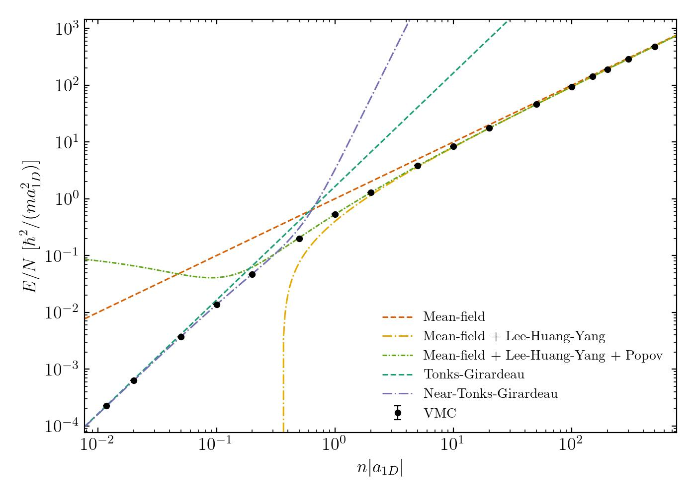
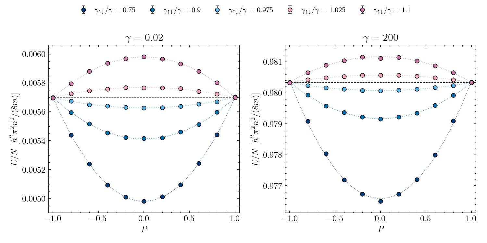

# BoseGases1D

This repository provides variational and diffusion Quantum Monte Carlo tools to
simulate the zero-temperature ground state of one-dimensional two-component
Bose gases with repulsive contact interactions.

## Equation of state of a single-component Bose gas

For density $n$, the figure compares the Monte Carlo energy per particle with
standard limiting expressions. For repulsive interactions, $a_{1D}<0$; define
$\gamma=2/(n|a_{1D}|)$. In units $\hbar=m=1$, the weak-coupling terms are

$$
\frac{E_{\rm MF}}{N}=\frac{n}{|a_{1D}|},\qquad
\frac{\Delta E_{\rm LHY}}{N}=-\frac{4\sqrt{2}}{3\pi}
\frac{\sqrt{n}}{|a_{1D}|^{3/2}},\qquad
\frac{\Delta E_{\rm Popov}}{N}=
\left(\frac{1}{3}-\frac{2}{\pi^2}\right)\frac{1}{|a_{1D}|^2},
$$

with successive approximations $E_{\rm MF}$, $E_{\rm MF}+\Delta E_{\rm LHY}$,
and $E_{\rm MF}+\Delta E_{\rm LHY}+\Delta E_{\rm Popov}$. In the
strong-coupling regime,

$$
\frac{E_{\rm TG}}{N}=\frac{\pi^2 n^2}{6},\qquad
\frac{E_{\rm nTG}}{N}=\frac{\pi^2 n^2}{6}
\left(1-2n|a_{1D}|+3(n|a_{1D}|)^2\right).
$$

## Phase separation in a two-component Bose gas

For a symmetric mixture, mean-field theory predicts phase separation when the
inter-species coupling $g_{\uparrow\downarrow}$ exceeds the intra-species
coupling $g$. The energy-versus-polarization curves show this same threshold
from weak to strong coupling across the interaction range shown
($\gamma=0.02$ to $200$).

